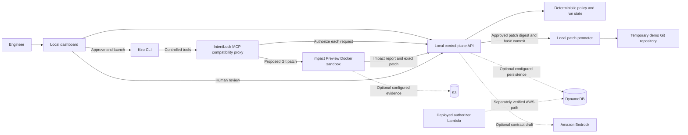

# IntentLock

IntentLock lets a security, platform, or DevOps team give a coding agent a narrow mission without giving it unrestricted access to the repository. A human approves a mission contract; a deterministic policy checks every controlled tool request. Its Impact Preview feature checks proposed edits in a networkless Docker sandbox and automatically runs the checks that cover the changed files, chosen from a fixed administrator-owned catalogue; a separate promoter applies only the exact patch a human reviewed.

## The problem

Coding agents are given broad repository access and little accountability: they can read secrets, edit CI or dependency files, or follow instructions planted in a file they read, and "the tests pass" is not evidence that a change is safe. When something goes wrong there is rarely a clean off-switch or a record of what the agent was allowed to do. IntentLock narrows each run to a human-approved mission, checks every controlled tool call, tests the proposed change in isolation before it touches the repository, and keeps an audit trail.

## Quickstart

This starts the whole demo on one Mac. Everything runs on localhost against a temporary copy of the demo repository, so your source checkout is not modified. See [the demo runbook](docs/demo-runbook.md) for a five-minute presentation sequence, a recording checklist and fallbacks. The [recorded evidence](docs/demo-evidence/README.md) includes one browser-driven run where real Kiro proposed an unsafe patch that was blocked and a corrected patch that was reviewed and promoted.

**Prerequisites:** Docker Desktop running, Kiro CLI installed and logged in (`kiro-cli whoami` succeeds), Python 3.12+, and Node.js with npm.

1. Install dependencies from the repository root:

   ```bash
   python3 -m venv .venv
   .venv/bin/pip install -r apps/api/requirements-dev.txt
   cd apps/web && npm ci && cd ../..
   ```

2. In a private terminal, create fresh local secrets. Do not commit them or show this terminal when presenting:

   ```bash
   export INTENTLOCK_INTERNAL_TOKEN="$(openssl rand -hex 24)"
   export INTENTLOCK_PROMOTER_TOKEN="$(openssl rand -hex 24)"
   export INTENTLOCK_REVIEWER_TOKEN="$(openssl rand -hex 24)"
   export INTENTLOCK_REVIEWER_TOKENS="{\"demo-user\":\"$INTENTLOCK_REVIEWER_TOKEN\"}"
   ```

3. Optional: let Amazon Bedrock draft the mission contract. Without these, use the dashboard's labelled fixture draft; it goes through the same approval and policy checks.

   ```bash
   export AWS_PROFILE=<profile-with-bedrock-access>
   export AWS_REGION=us-east-1
   export INTENTLOCK_BEDROCK_MODEL_ID=us.anthropic.claude-haiku-5-5
   ```

4. Check prerequisites, then start the stack in the same terminal:

   ```bash
   bash demo/start_local_demo.sh --check
   bash demo/start_local_demo.sh
   ```

5. Open **http://localhost:5173/**, create a mission, review and approve the contract, and launch Kiro. The reviewer name is `demo-user`; use `INTENTLOCK_REVIEWER_TOKEN` when approving a patch.

The script builds the `intentlock-impact-preview:local` Docker image, creates a fresh temporary Git repository, and starts the promoter (`127.0.0.1:8790`), API (`127.0.0.1:8787`) and dashboard (`localhost:5173`). It does not print tokens. If one of those ports is in use it exits with code 2 and names the process holding it; either stop that process or set `INTENTLOCK_DEMO_API_PORT`, `INTENTLOCK_DEMO_PROMOTER_PORT` and `INTENTLOCK_DEMO_WEB_PORT` to free ports. Press Ctrl-C in the startup terminal to stop the stack.

## What is implemented

- **IntentLock:** Bedrock can propose a contract; human approval activates it; deterministic rules authorize the eight Kiro MCP tools (`list_files`, `read_file`, `search_code`, `propose_patch`, `run_approved_test`, `run_approved_command`, `request_permission`, `finish_task`) and record decisions. Stop makes a run ineligible for more tool calls and promotion.
- **Impact Preview:** proposed TypeScript/Node patches run in a read-only-root, no-network Docker container against checks chosen from the changed paths (see [Check catalogue](#check-catalogue-and-automatic-selection)). Protected paths and test changes are blocked. A passing patch still needs an authenticated human review and exact-hash promotion.
- **Evidence:** local or private S3 artifact storage, immutable final audits, a DynamoDB-backed control-plane option, and a separately deployed authorization Lambda with CloudWatch authorization metrics.

The verified browser demo uses the **local** MCP compatibility proxy, Docker sandbox, in-memory API store, and local artifacts. S3, DynamoDB, Lambda, CloudWatch, and Bedrock have been exercised separately as described in the [Person 2 handoff](docs/handoffs/person2-execution-plane.md). AgentCore Gateway and Code Interpreter are not deployed; the local fallback is documented for the hackathon. The dashboard/API are not a public production deployment.

### AWS services

| Service | Role in IntentLock | Status |
| --- | --- | --- |
| Amazon Bedrock | Drafts the mission contract (`us.anthropic.claude-haiku-5-5`). A human must approve it; Bedrock never makes an access decision. | Live draft recorded in a [dashboard screenshot](docs/demo-evidence/README.md). Optional: a labelled fixture draft is the fallback. |
| Amazon DynamoDB | Control-plane persistence (contracts, runs, events). | Deployed and tested separately. The browser demo uses the in-memory store. |
| AWS Lambda | Stateless authorizer that returns allow/deny for a tool request, failing closed on any error. | Deployed and tested separately. The browser demo uses the local API instead. |
| Amazon S3 | Private, encrypted evidence bucket for Impact Preview artifacts and immutable final audits; also the read-only source for Security Replay. | Tested separately with real S3. The browser demo writes local artifacts by default. |
| Amazon CloudWatch | Authorization metrics (such as `AuthorizationLatencyMs`, `ToolRequestsAllowed`, `ToolRequestsDenied`) emitted by the Lambda. | Verified from the deployed Lambda. The other PRD metrics are not emitted. |
| Bedrock AgentCore Gateway and Code Interpreter | Intended policy interception and sandbox execution. | **Not deployed.** Replaced by the local MCP compatibility proxy and a locked-down Docker sandbox. |

"Tested separately" means each service was exercised on its own, as recorded in the [Person 2 handoff](docs/handoffs/person2-execution-plane.md), and not as one deployed dashboard-to-AWS path.

Older handoff entries and recorded screenshots use the former feature name. They are preserved as historical evidence; current code and instructions call the feature **Impact Preview**.

## Architecture and demo boundary



The solid arrows are the verified localhost product flow. Dotted arrows identify AWS components exercised separately; they are not a single deployed dashboard-to-AgentCore path. Kiro runs outside Docker. Docker isolates patch evaluation, and the promoter changes the temporary repository only after human approval.

## Check catalogue and automatic selection

The checks Impact Preview can run live in an administrator-owned catalogue (`packages/impact-analyzer/catalogue.json`). It is loaded by host-side code only and is never visible to the agent. Each entry has an ID, a kind (`test` or `static`), a fixed command line, the path globs it covers, and a timeout. The demo catalogue has `auth-tests`, `payments-tests` and `typecheck`; the TypeScript compiler version is pinned into the sandbox image, so no network is needed at run time.

- **Contracts reference IDs, never commands.** A contract's approved checks must match the catalogue definition exactly; any unknown or altered entry fails closed before Docker starts.
- **Selection is automatic.** After a patch is applied in the sandbox, the checks whose path globs cover the changed files are chosen on the host. Static checks marked `always` run on every code change.
- **Missing coverage is a finding.** A changed path that no approved check covers raises `INSUFFICIENT_TEST_COVERAGE`: blocking for sensitive paths (`src/auth/**`, `src/payments/**`) and `review_required` elsewhere. Docs-only changes are exempt.
- **`run_approved_command(command_id)`** lets the agent run one approved check by ID on the original clean base, with no network. The agent supplies only the ID. It does not test a proposed patch; the `propose_patch` impact report does that. The tool descriptions list the IDs the active contract approved, so the agent does not have to guess.

This goes beyond the seven-tool, auth-test-only sandbox first scoped in the PRD. It adds no arbitrary shell, no package installation and no agent-supplied command lines.

## Security Replay

`#/replay` in the dashboard is a read-only reconstruction of a recorded run: the security timeline, **Check 1 — action authorization** (the recorded IntentLock decision) beside **Check 2 — consequence verification** (the recorded Impact Preview report), the hash-verified patch, trusted-test results, review, promotion and the final audit reference. It reads persisted evidence, so it works after an API restart:

| Source | Configure | Contains |
| --- | --- | --- |
| S3 evidence bucket (read-only) | `INTENTLOCK_REPLAY_BUCKET` + `AWS_PROFILE` (never `default`) | Impact Preview artifacts and `audit/final.json` exports |
| Local artifact directory | `INTENTLOCK_ARTIFACT_DIR` (set by `demo/start_local_demo.sh`) | same layout, written by the local demo |
| Live control-plane store | always on, by run ID | runs not yet exported (in-memory store: lost on restart) |

Runs without an audit export show only their Impact Preview artifacts, and every missing record is labelled *Evidence unavailable* rather than inferred. `apps/api/record_replay_scenario_a.py` records a real authorized-read / denied-`.env` run without Docker or Kiro. Exact demo steps are in the [Person 1 handoff](docs/handoffs/person1-control-plane.md) (Milestone 11).

## Limitations

- **Enforcement boundary.** IntentLock authorizes requests that go through its MCP tools. Kiro itself runs outside Docker, and IntentLock does not stop other ways the agent process could act on the machine. The Docker sandbox only isolates patch evaluation.
- **Narrow scope.** Kiro CLI only, and TypeScript/Node repositories only. Impact Preview runs just the checks in the fixed catalogue; there is no arbitrary shell, package installation or agent-supplied command line.
- **Coverage is only as good as the catalogue.** A changed path with no approved check is reported as missing coverage, not silently passed.
- **Local demo, not a deployment.** The verified flow uses in-memory state and local artifacts on one machine. The AWS services above were verified separately, and the deployed Lambda runs older code than this checkout. AgentCore Gateway and Code Interpreter are not deployed.
- **Not production-hardened.** Reviewer actions require a token, but the public API has no general authentication and must stay on localhost. Runtime IAM roles are not narrowed, and there is no rate limit on the Bedrock proposal endpoint.
- **Nondeterministic agent.** Kiro may take a different route on each run. The recorded evidence is from one run and is not a guarantee of how a new run will go.
- **Measurements.** Only authorization latency has been measured, so no throughput or cost figures are claimed.

## Project map

| Path | Purpose |
| --- | --- |
| `apps/web` | React dashboard |
| `apps/api` | contract, policy, run, review, and promotion API |
| `apps/mcp-server` | Kiro CLI MCP profile and supervisor |
| `packages/sandbox-provider` | Docker patch preview and artifact storage |
| `packages/patch-promoter` | independent exact-patch promotion |
| `infrastructure` | AWS templates and deployment notes |
| `docs/demo-evidence` | screenshots from the verified local flow |

The supported scope and security claim boundaries are in the [threat model](docs/threat-model.md); the shared contract schemas are in [packages/contracts](packages/contracts/README.md).
