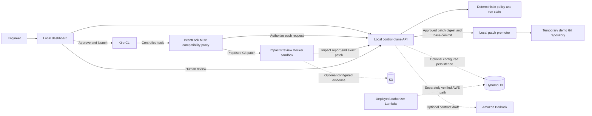

# IntentLock

IntentLock lets a security, platform, or DevOps team give a coding agent a narrow mission without giving it unrestricted access to the repository. A human approves a mission contract; a deterministic policy checks every controlled tool request. Its Impact Preview feature checks proposed edits in a networkless Docker sandbox and runs fixed tests; a separate promoter applies only the exact patch a human reviewed.

## Demo

See [the demo runbook](docs/demo-runbook.md) for a one-command localhost stack, a five-minute presentation sequence, recording checklist, and fallback screenshots. The [recorded evidence](docs/demo-evidence/README.md) includes one browser-driven run where real Kiro proposed an unsafe patch that was blocked and a corrected patch that was reviewed and promoted.

```bash
# After installing the Python and web dependencies and setting private tokens
bash demo/start_local_demo.sh --check
bash demo/start_local_demo.sh
```

The script creates a fresh temporary copy of the demo repository and starts the API, promoter, and dashboard on localhost. It does not alter this source repository.

## What is implemented

- **IntentLock:** Bedrock can propose a contract; human approval activates it; deterministic rules authorize the seven Kiro MCP tools and record decisions. Stop makes a run ineligible for more tool calls and promotion.
- **Impact Preview:** proposed TypeScript/Node patches run in a read-only-root, no-network Docker container against fixed tests. Protected paths and test changes are blocked. A passing patch still needs an authenticated human review and exact-hash promotion.
- **Evidence:** local or private S3 artifact storage, immutable final audits, a DynamoDB-backed control-plane option, and a separately deployed authorization Lambda with CloudWatch authorization metrics.

The verified browser demo uses the **local** MCP compatibility proxy, Docker sandbox, in-memory API store, and local artifacts. S3, DynamoDB, Lambda, CloudWatch, and Bedrock have been exercised separately as described in the [Person 2 handoff](docs/handoffs/person2-execution-plane.md). AgentCore Gateway and Code Interpreter are not deployed; the local fallback is documented for the hackathon. The dashboard/API are not a public production deployment.

Older handoff entries and recorded screenshots use the former feature name. They are preserved as historical evidence; current code and instructions call the feature **Impact Preview**.

## Architecture and demo boundary



The solid arrows are the verified localhost product flow. Dotted arrows identify AWS components exercised separately; they are not a single deployed dashboard-to-AgentCore path. Kiro runs outside Docker. Docker isolates patch evaluation, and the promoter changes the temporary repository only after human approval.

## Security Replay

`#/replay` in the dashboard is a read-only reconstruction of a recorded run: the security timeline, **Check 1 — action authorization** (the recorded IntentLock decision) beside **Check 2 — consequence verification** (the recorded Impact Preview report), the hash-verified patch, trusted-test results, review, promotion and the final audit reference. It reads persisted evidence, so it works after an API restart:

| Source | Configure | Contains |
| --- | --- | --- |
| S3 evidence bucket (read-only) | `INTENTLOCK_REPLAY_BUCKET` + `AWS_PROFILE` (never `default`) | Impact Preview artifacts and `audit/final.json` exports |
| Local artifact directory | `INTENTLOCK_ARTIFACT_DIR` (set by `demo/start_local_demo.sh`) | same layout, written by the local demo |
| Live control-plane store | always on, by run ID | runs not yet exported (in-memory store: lost on restart) |

Runs without an audit export show only their Impact Preview artifacts, and every missing record is labelled *Evidence unavailable* rather than inferred. `apps/api/record_replay_scenario_a.py` records a real authorized-read / denied-`.env` run without Docker or Kiro. Exact demo steps are in the [Person 1 handoff](docs/handoffs/person1-control-plane.md) (Milestone 11).

## Project map

| Path | Purpose |
| --- | --- |
| `apps/web` | React dashboard |
| `apps/api` | contract, policy, run, review, and promotion API |
| `apps/mcp-server` | Kiro CLI MCP profile and supervisor |
| `packages/sandbox-provider` | Docker patch preview and artifact storage |
| `packages/patch-promoter` | independent exact-patch promotion |
| `infrastructure` | AWS templates and deployment notes |
| `docs/demo-evidence` | screenshots from the verified local flow |

The supported scope and security claim boundaries are in the [threat model](docs/threat-model.md); the shared contract schemas are in [packages/contracts](packages/contracts/README.md).
